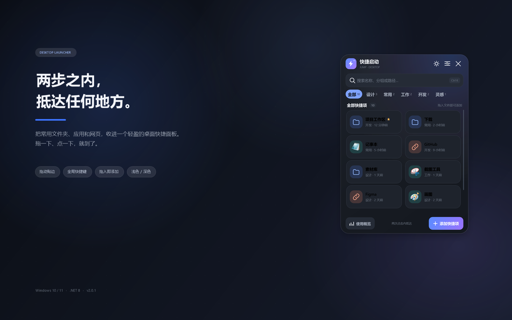

# Jump · Desktop Jump List

一个安静、快速、可拖动的 Windows 桌面快捷启动器。常驻屏幕边缘的一枚悬浮按钮，单击展开快捷面板，把常用文件夹、文件、应用和网页收进两次点击之内。

> v2.0.1 · 灵动岛式中央面板：更小的侧边胶囊、不裁切的悬停动效、400×560 居中面板。


## 为什么重写

旧版有三个明显问题：

- **拖不动**：在 `Button` 的鼠标事件里混用 `CaptureMouse()`、`DragMove()` 和 `Click`，拖动与点击互相抢占，窗口还会在拖动结束时跳回边缘。
- **界面缺乏设计**：深紫底色、字符图标、独立弹出的旧式编辑窗口，层级和节奏都比较粗糙。
- **没有数据图表**：看不到使用频率、最近节奏，也没有任何可视化反馈。

v2 将交互、视觉和数据层一起重做：手动实现逐帧拖动与阈值判定，重画整套浅色/深色设计系统，编辑、设置、撤销都在面板内完成，并加入完全自绘的 7 天趋势、类型构成与常用排行图表。

## 界面

| 浅色 | 深色 |
| --- | --- |
|  |  |

| 使用概览 | 面板内编辑 |
| --- | --- |
|  |  |


完整设计系统（色板、字体、组件、交互原则）见 [设计说明](docs/DESIGN.md) 与 [设计板](docs/design-board.png)：

[](docs/design-board.png)

## 功能

- **可靠的拖动**：按住悬浮球拖动，4px 阈值区分点击与拖动，松手后平滑吸附到最近屏幕边缘，并记住位置。
- **快速展开**：单击悬浮球展开面板；点击面板外、按 `Esc` 或再次点击悬浮球收起。
- **全局快捷键**：`Ctrl + Alt + J` 在任何应用中呼出或收起面板。
- **搜索与分组**：按名称、分组、路径或类型即时过滤；分组 chip 带数量；上下方向键选择，`Enter` 打开。
- **四种快捷项**：文件夹、文件、应用、网页；文件和 `.exe` 自动读取 Windows Shell 图标。
- **拖入即添加**：把文件或文件夹直接拖进面板，自动识别类型、命名并保存。
- **面板内编辑**：添加、编辑、分组全部在面板内完成，不再弹出独立的旧式窗口。
- **删除可撤销**：删除后出现 3.8 秒撤销提示，误删不用重来。
- **使用概览**：自绘 7 天柱状图、类型环形图、常用排行和进度条，完全离线，无第三方图表库。
- **浅色 / 深色 / 跟随系统**：运行时即时切换并记忆。
- **轻量常驻**：系统托盘、单实例运行、开机启动、原子写入的本地 JSON 配置。
- **清晰图标**：自定义应用的渐变闪电图标，托盘与安装器共用。

## 快捷键

| 操作 | 快捷键 |
| --- | --- |
| 呼出 / 收起面板 | `Ctrl + Alt + J` |
| 聚焦搜索 | `Ctrl + K` |
| 新建快捷项 | `Ctrl + N` |
| 打开使用概览 | `Ctrl + I` |
| 选择快捷项 | `↑` / `↓` |
| 打开选中项 | `Enter` |
| 清空搜索 / 关闭面板 | `Esc` |

在快捷项上右键可以打开、编辑、置顶、在资源管理器中显示或删除。

## 使用

1. 启动程序后，屏幕边缘会出现 40 × 40 的轻量悬浮胶囊。
2. 按住胶囊上下拖动可以调整位置，松手会自动贴边。
3. 单击胶囊后，它会从中央的 100 × 44 胶囊流体展开为 400 × 560 的居中面板；搜索或点击分组找到目标。
4. 点击“添加快捷项”，或在编辑器中填写名称、目标和分组。
5. 也可以从资源管理器把文件、文件夹直接拖进面板。
6. 点击“使用概览”查看最近 7 天启动次数、类型构成和常用排行。

## 数据与隐私

所有数据只保存在本机，不联网、不上传：

```text
%LocalAppData%\DesktopJumpList\
├── shortcuts.json   # 快捷项
├── settings.json    # 主题、贴边位置、快捷键
└── usage.json       # 每日启动次数
```

- 写入采用临时文件 + 原子替换，避免中途损坏配置。
- 读取到损坏的 `shortcuts.json` 时会自动备份为 `.corrupt-时间戳`，不会阻止程序启动。
- 从 v1 升级时会自动兼容旧的 PascalCase / 数字枚举数据。
- `--preview` / `--shot` 使用独立的 `preview` 子目录，不会接触真实数据。

## 开发

要求：Windows 10/11、.NET 8 SDK。

```powershell
dotnet build .\src\DesktopJumpList\DesktopJumpList.csproj
dotnet run --project .\src\DesktopJumpList\DesktopJumpList.csproj
```

发布精简运行版（需要 .NET 8 Desktop Runtime）：

```powershell
dotnet publish .\src\DesktopJumpList\DesktopJumpList.csproj `
  -c Release -r win-x64 --self-contained false `
  -o .\artifacts\DesktopJumpList-v2.0.1-runtime
```

安装器脚本位于 `installer\DesktopJumpList.iss`，使用 Inno Setup 6 编译。本次发布已生成：

```text
artifacts\
├── DesktopJumpList-v2.0.1-runtime\   # 精简运行版（需 .NET 8 Desktop Runtime）
├── DesktopJumpList-v2.0.1-single\    # 单文件版（需 .NET 8 Desktop Runtime）
└── installer\
    └── DesktopJumpList-Setup-v2.0.1.exe
```

### 预览与截图

```powershell
# 以独立预览数据启动
.\src\DesktopJumpList\bin\Debug\net8.0-windows\DesktopJumpList.exe --preview --theme=light

# 输出透明面板 PNG（2x），供文档合成
.\src\DesktopJumpList\bin\Debug\net8.0-windows\DesktopJumpList.exe `
  --preview --theme=dark --view=insights --shot=.\artifacts\preview\insights.png
```

`--view` 支持 `shortcuts`、`insights`、`insights-bottom`、`editor`、`settings`、`empty`、`dock`。

文档图片的完整生成流程：

```powershell
.\tools\capture-previews.ps1   # 生成 12 张透明面板图
.\tools\compose-docs.ps1       # 合成 docs/screenshots 与 docs/design-board.png
```

## 技术方案

- **C# + WPF + .NET 8 for Windows**，无第三方 NuGet 依赖。
- 自绘控件：`Controls/BarChart.cs`、`Controls/DonutChart.cs` 使用 `DrawingContext` 绘制并做揭示动画。
- 无边框分层窗口 + `PerMonitorV2` DPI 声明；面板展开时按鼠标所在显示器定位并夹紧在工作区内。
- 单实例：命名 Mutex + 命名事件；第二次启动会通知已有实例展开面板。
- 全局快捷键：`RegisterHotKey` + `HwndSource` 消息钩子。
- Shell 图标：`SHGetFileInfo` + `Imaging.CreateBitmapSourceFromHIcon`，带缓存。
- 数据：`System.Text.Json`，字符串枚举 + 旧数字格式兼容。

## 项目结构

```text
desktop-jump-list/
├── src/DesktopJumpList/
│   ├── Controls/          # 柱状图、环形图
│   ├── Converters/        # 图标、枚举、可见性转换器
│   ├── Helpers/           # ObservableObject、RelayCommand
│   ├── Models/            # 快捷项、设置、使用数据、图表模型
│   ├── Services/          # 存储、启动、图标、主题、热键、预览数据
│   ├── Themes/            # Light / Dark 色板与共用控件样式
│   ├── Views/             # LauncherPanel（主面板 + 编辑 + 设置）
│   ├── ViewModels/
│   ├── MainWindow.xaml    # 悬浮球、拖动、贴边、展开动画
│   └── App.xaml           # 单实例、启动流程、全局异常
├── docs/                  # 设计说明、设计板、截图
├── installer/             # Inno Setup 脚本
├── tools/                 # 文档截图合成脚本
└── artifacts/             # 构建与发布产物（不进入版本控制）
```

## 已知边界

- 多显示器且缩放比例不同时，窗口位置以当前显示器 DPI 换算；极端跨屏拖动仍建议手动微调。
- 全局快捷键目前通过 `settings.json` 的 `hotkey` 字段配置，设置页展示占用状态。
- 自定义快捷项图标路径已保留在数据模型中，当前界面优先使用系统 Shell 图标。

## 许可

个人项目，供学习与自用。
