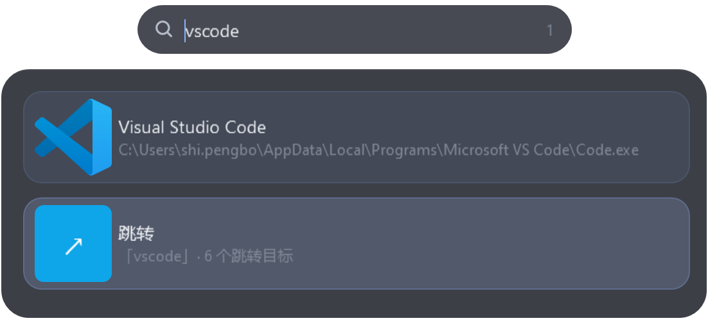
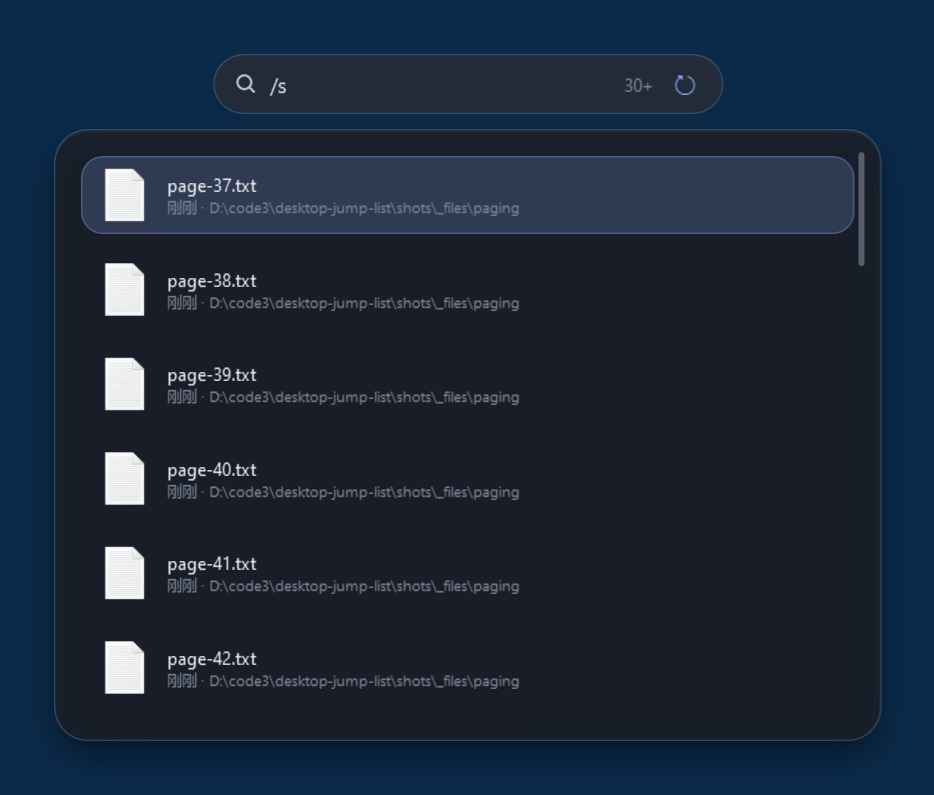
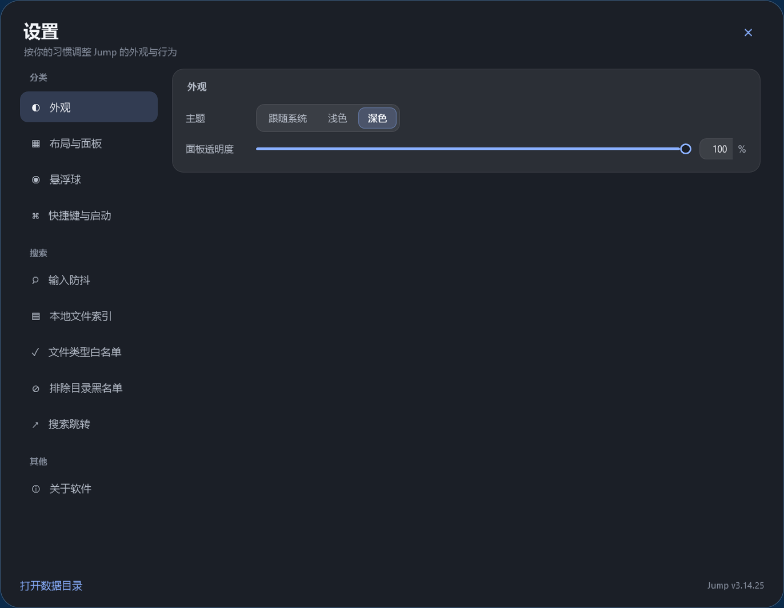

# Jump · 桌面快捷启动器

<p align="center"></p>

<p align="center">常驻屏幕边缘的一个圆点，把常用的文件、文件夹、应用和网页收进来，随时秒开。<br>
Windows 10 / 11 · 免管理员权限 · 数据只存本机 · 开源</p>

<p align="center"></p>

## 功能

### 悬浮球，随叫随到
圆点可以吸附到屏幕任意边缘，鼠标移上去面板就滑出来；贴边后自动收成一条细线，不占任务栏、不进 Alt+Tab。

### 磁贴面板
图标 + 名称的网格，拖拽即排序、合并成组、右键固定或移除。图标从源文件里取最大的一份，任意缩放下都清晰，快捷方式也不会多出一个箭头。

### 输入即搜
中文、英文、全拼、拼音首字母都能命中（`weixin`、`wx` 都能找到微信）；方向键加 Enter，全程不用鼠标。

<p align="center"></p>

### 本地文件检索 `/s`
`/s 关键词` 检索整个磁盘上的文件、文件夹和已安装应用。多个关键词用空格分开、**不分先后**（`/s 2026 11 csv`、`/s csv 11 2026` 命中同一批文件），文件名支持全拼与首字母（`weiguimingxi`、`wgm` 都能找到「违规明细」）。排序优先看文件名本身：同名 > 前缀 > 词首 > 包含 > 首字母/全拼 > 缩写 > 只命中目录；同一档里优先你从搜索结果里打开过的那几个、再按修改时间。不写 `/s` 也能让普通搜索带上本地文件结果，开关在设置里。

<p align="center"></p>

### 网页跳转
输入框里敲一句，结果里就有「跳转」入口，回车进入二级列表再挑百度 / 谷歌 / 必应等目标，用默认浏览器打开。

### 外观随你调
深浅主题、面板透明度、图标与文字大小、间距都可调；悬浮球的大小、颜色、圆角、吸附距离、自动收起也都能改。

<p align="center"></p>

## 安全

- **数据只在本机**：配置、磁贴、索引、下载统计都写在 `%LocalAppData%\DesktopJumpList` 下的几个文件里，不上传、不同步到云端。
- **没有账号，也没有埋点**：不收集使用行为，不上报崩溃，不接第三方统计。
- **只在两件事上联网，且只访问 `api.github.com`**（本仓库的 Releases 接口）：点「检查更新」时查最新版本；「下载统计」刷新时取各版本下载量（一小时内复用本地缓存）。其余网页一律交给默认浏览器打开。
- **不需要管理员权限**：安装到当前用户目录，开机自启写在 `HKCU`，卸载时一并清掉。
- **索引只读元数据**：只记录目录项的名字、大小、时间和文件 ID，不打开文档内容；图标取自程序自身的图标资源。不修改、不移动、不删除任何文件。
- **索引范围由你决定**：只遍历你勾选的磁盘，配合扩展名白名单与黑名单（支持 `*.bak`、`*\node_modules\*` 这类通配符，默认排除系统目录、程序目录、回收站、卷信息与临时目录）。
- **剪贴板按需读取**：只有你按 Ctrl+V 或使用右键菜单时才读，读完即用，不落盘。
- **搜索词不留存**：输入的查询只用于当次检索，不写日志。
- **源码可审计**：MIT 协议，全部代码在此仓库，可以自行编译核对。

## 下载

见 [Releases](https://github.com/1182793425/Desktop-Jump-List/releases)。每个版本只提供安装包 `Jump-<版本号>-setup.exe`，装完即用，不依赖额外运行时。

## 发版规则

应用内置「检查更新」，发版必须遵守，否则用户端收不到更新：

1. **版本号唯一来源是仓库根目录的 `.env`**（`APP_VERSION=`），csproj 与安装脚本都读它，不要手改代码里的版本号。
2. **Tag**：`v<版本号>` 打在 main 最新提交上，Release 的 target 为 `main`。
3. **资产**：每个 Release 只带一个 `Jump-<版本号>-setup.exe`。名字不符，应用认不出来。
4. **不要勾选 pre-release**：应用经 `releases/latest` 取版本，草稿与预发布不会被返回。
5. **换包必须升版本号**：只替换已发布版本的同名资产不会触发更新提示，还会清零下载计数。
6. **说明用中文**，格式参照历史版本。
7. **索引结构变了就升 `INDEX_VERSION`**：`.env` 里的 `INDEX_VERSION` 是索引文件的结构版本，只有 index.bin 的行格式或含义变化时才 +1（普通功能升级不要动）。程序把该版本写进索引文件头，加载时比对：不一致、或旧索引里根本没有这个字段，就自动重建索引，用户不需要手动操作。

## 构建

```powershell
dotnet build   .\src\DesktopJumpList\DesktopJumpList.csproj
dotnet publish .\src\DesktopJumpList\DesktopJumpList.csproj -c Release -r win-x64 --self-contained true -o .\artifacts\publish
# 安装包：用 Inno Setup 6 编译 installer\DesktopJumpList.iss
```

## 许可

[MIT License](LICENSE)。个人项目，供学习与自用，欢迎试用、修改与分发。
