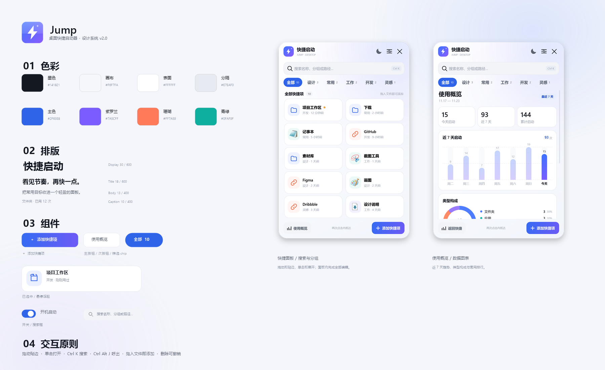
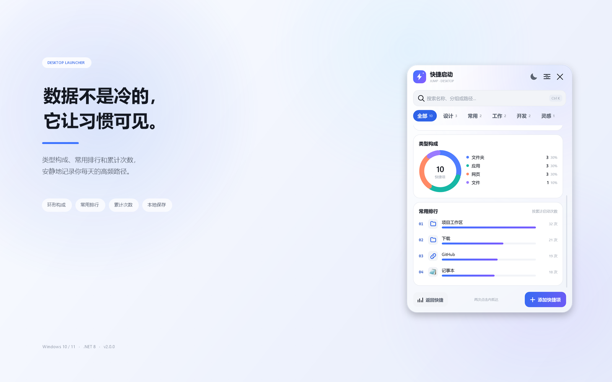

# Jump · 设计说明

> v2.0.0 设计系统与交互说明。目标不是“多一个启动器”，而是让桌面边缘多一个**安静、明确、值得信任**的入口。



## 1. 设计目标

| 关键词 | 具体表现 |
| --- | --- |
| 快速 | 单击展开、点击即打开；搜索、方向键、`Enter`、全局快捷键都能完成主路径 |
| 简单 | 一个悬浮球、一个面板、一个搜索框；没有多层菜单和独立编辑窗口 |
| 明朗 | 浅色为默认视觉，留白充足；深色不是简单反色，而是重新配色的夜间版本 |
| 可靠 | 拖动不跳、位置可记忆、删除可撤销、配置原子写入 |

设计概念是“**一枚安静的桌面跳板**”：收起时只占 60×60，像桌面边缘的一颗小石子；展开时成为一块 432×648 的磨砂玻璃面板，信息密度刚好，不打断工作内容。

## 2. 视觉系统

### 色彩

| Token | 浅色 | 深色 | 用途 |
| --- | --- | --- | --- |
| Canvas | `#F6F7FA` | `#0D0F14` | 桌面/预览背景 |
| Surface | `#FFFFFF` | `#1D222B` | 面板、卡片 |
| Surface Alt | `#F2F4F8` | `#252B36` | 输入框、分组底 |
| Ink | `#141821` | `#F3F5FA` | 主文字 |
| Ink Secondary | `#5C6472` | `#A5ADBB` | 次级文字 |
| Ink Tertiary | `#98A0AD` | `#6D7684` | 说明文字 |
| Line | `#E7EAF0` | `#2C323D` | 描边、分隔 |
| Accent | `#2F63E8` | `#7EA2FF` | 主操作、选中态 |
| Violet | `#7A5CFF` | `#A98BFF` | 渐变、类型标识 |
| Coral | `#FF7A59` | `#FF9275` | 网页类型、环形图 |
| Teal | `#0FAF9F` | `#3FD3C3` | 应用类型、环形图 |
| Amber | `#F0A33A` | `#F2B45A` | 置顶星标 |

- 浅色面板使用白到浅灰蓝的对角渐变，右上角有一层极淡的蓝紫光晕，避免纯白面板显得扁平。
- 深色面板使用 `#1C212A → #14181F`，光晕透明度降低，描边改为低对比白色，保持夜间的安静感。
- 强调色始终只用于“当前可操作/当前选中”的地方，不用大面积铺色。

### 字体

| 层级 | 字号 / 字重 | 示例 |
| --- | --- | --- |
| Display | 30 / 600 | 使用概览标题 |
| Page Title | 19 / 600 | 设置、编辑标题 |
| Section | 12.5 / 600 | 全部快捷项 |
| Body | 12.5 / 400 | 快捷项名称 |
| Caption | 9.5–11 / 400 | 路径、时间、说明 |

字体栈：`Segoe UI Variable Display` → `Segoe UI` → `Microsoft YaHei UI`。数字（次数、日期）使用等宽字体 `Cascadia Code`，在排行榜和统计数据里对齐更稳。

### 间距、圆角、阴影

- 4px 基准网格；面板内边距 16px，卡片间距 6px，分组间距 10px。
- 圆角：面板 26、卡片 16、输入框 11/12、按钮 12、chip 15、悬浮球 20。
- 面板阴影：`Blur 30 / Depth 8 / Opacity 0.26`，在分层窗口中用透明外边距预留阴影空间。
- 卡片默认只有 1px 描边；悬停才轻微上浮 1px 并加深描边，避免满屏阴影造成噪声。

### 动效

| 场景 | 时长 | 曲线 |
| --- | --- | --- |
| 面板展开 | 180ms 淡入 + 230ms 0.975→1 | CubicEase Out |
| 面板收起 | 140ms | CubicEase In |
| 编辑/设置浮层 | 170–260ms | CubicEase Out |
| 图表揭示 | 480–560ms | CubicEase Out |
| Toast | 150–200ms | CubicEase Out |
| 拖动贴边 | 180ms | CubicEase Out |

所有动画都只改变透明度、缩放和位移，不改变布局树；只有面板展开/收起会调整窗口尺寸。

## 3. 布局

```text
┌────────────────────────────── 432 × 648 ─────────────────────────────┐
│ 62  Brand + 主题 / 设置 / 收起                                        │
│ 56  搜索框（Ctrl K）                                                  │
│ 40  分组 chips（全部、设计、常用、工作、开发、灵感）                  │
│ 26  列表标题 + 数量 / 拖入提示                                        │
│ *   2 列快捷卡片（图标、名称、分组·时间、更多）                        │
│ 64  使用概览 / 提示 / 添加快捷项                                      │
└──────────────────────────────────────────────────────────────────────┘
```

- 面板固定宽度，展开时根据悬浮球在屏幕左/右半区向内展开；高度按工作区夹紧，小屏也不会超出。
- 快捷项使用 2 列卡片：40px 图标块 + 名称 + 分组/最近使用；右侧 `⋮` 只在悬停或选中时出现。
- 列表底部与 footer 之间保留 10px 呼吸空间；空状态居中展示插画、说明和唯一的添加入口（搜索无结果时不重复显示按钮）。

## 4. 组件

| 组件 | 说明 |
| --- | --- |
| 悬浮球 | 60×60 渐变方块，白色闪电；按住拖动，单击展开；悬停 1.035 倍缩放 |
| 搜索框 | 42px 圆角输入，聚焦时描边变为 Accent；右侧 `Ctrl K` 键帽或清空按钮 |
| 分组 chip | 30px 胶囊，数量以 9.5px 低透明度数字跟随；选中时使用 Accent 底 |
| 快捷卡片 | 74px 高；Shell 图标或矢量类型图标；置顶星标；悬停上浮；右键菜单 |
| 编辑浮层 | 底部 inset sheet，包含类型分段、名称、目标、分组建议、错误内联提示 |
| 设置浮层 | 居中卡片，包含外观/启动/快捷键/数据/关于；危险操作使用红色文字 + 描边按钮 |
| Toast | 底部浮动 12px 圆角，深色底/白字（浅色主题），支持撤销 |
| 图表 | 7 天柱状图、类型环形图、排行进度条；全部用 WPF `DrawingContext` 自绘 |

## 5. 交互模型

### 拖动

旧实现的根本问题不是“没写拖动”，而是**事件所有权冲突**：`Button` 同时处理点击、捕获鼠标，又在 `PreviewMouseMove` 中调用阻塞式 `DragMove()`，导致点击/拖动互相抢占，且在 `MouseUp` 后重新贴边产生跳变。

新实现：

1. 悬浮球改为普通 `Border`，只监听 `PreviewMouseLeftButtonDown/Move/Up`，不再依赖 `Button.Click`。
2. 按下时记录屏幕坐标与窗口 `Left/Top`，`CaptureMouse()` 接管指针。
3. 移动超过 4px 才进入拖动，避免手抖误触；拖动时按屏幕坐标增量移动窗口，而不是依赖会被窗口移动影响的相对坐标。
4. 松手后根据窗口中心落在屏幕哪一半，平滑吸附到左/右边缘，并把纵向比例写入 `settings.json`。
5. 未超过阈值则回到“单击展开/收起”逻辑。

### 展开与收起

- 展开：先计算面板的最终矩形（按悬浮球所在边向内展开、按工作区夹紧），一次性设置窗口位置和尺寸，再淡入 + 0.975→1 缩放面板；避免逐帧缩放导致的布局抖动。
- 收起：140ms 淡出，结束后再缩回 60×60；悬浮球以 0.92→1 弹回，避免突然出现。
- 面板失焦自动收起；打开文件选择器、设置等模态操作时通过 `BeginModal/EndModal` 计数抑制误收起。
- 收起时清空搜索、关闭浮层并重置列表选择，下一次打开是干净的初始状态。

### 编辑与删除

- 编辑不再打开独立窗口，而是面板底部的 inset sheet；类型用四段控件切换，选择文件夹/文件时“浏览”按钮才出现。
- 名称、目标、分组都支持占位提示与行内错误；`Enter` 保存，`Esc` 取消。
- 删除后立即从列表移除并显示带“撤销”的 Toast；撤销把原对象插回原索引并重新排序分组。

### 键盘

`Ctrl+K` 搜索、`Ctrl+N` 新建、`Ctrl+I` 概览、`↑/↓` 移动两列网格中的选择、`Enter` 打开、`Esc` 逐层关闭。悬浮球无焦点依赖，`Ctrl+Alt+J` 在任何应用中呼出。

## 6. 数据图表

使用数据完全本地：

- 每次打开快捷项，`usage.json` 对应本地日期 +1，同时快捷项的 `openCount` 和 `lastOpenedAt` 更新。
- **7 天柱状图**：自绘圆角柱，今天使用渐变强调，其余为低透明度；柱顶显示次数，底部显示星期；`Reveal` 动画 480ms。
- **类型环形图**：按文件夹/文件/应用/网页分组，圆角端点留 7° 间隙，中心显示快捷项总数；560ms 揭示。
- **常用排行**：按累计次数排序取前 4，显示名次、图标、进度条与次数。
- 图表颜色不依赖主题资源，保证切换深浅色后仍有稳定的类型识别；文字与网格线使用主题色。

这些控件位于 `src/DesktopJumpList/Controls/`，没有任何第三方图表依赖。



## 7. 可访问性与工程细节

- 主要按钮、搜索框、编辑字段都设置了 `AutomationProperties.Name`，便于 UI Automation 与读屏。
- 键盘焦点有明确的选中环；卡片选中环与卡片同尺寸，不随列表容器拉伸。
- 对比度：浅色主题主文字 `#141821` 对 `#FFFFFF`，深色主题 `#F3F5FA` 对 `#1D222B`；正文与说明文字分层，不依赖颜色单独传达状态。
- 所有颜色使用 `DynamicResource`，主题切换即时刷新；图表使用主题画刷绑定，无需重建。
- 数据目录隔离：预览/截图模式使用 `%LocalAppData%\DesktopJumpList\preview`，不会读写真实配置。

## 8. 文件与视觉资产

```text
Themes/Light.xaml · Dark.xaml     色板
Themes/Base.xaml                  字体、按钮、chip、输入框、菜单、滚动条、图表容器
Views/LauncherPanel.xaml          面板、卡片、编辑、设置、Toast、拖入浮层
MainWindow.xaml                   悬浮球、阴影、拖动与展开窗口
Controls/BarChart.cs              7 天柱状图
Controls/DonutChart.cs            类型环形图
docs/design-board.png             色板/字体/组件/交互设计板
docs/screenshots/                 产品截图（由 tools/compose-docs.ps1 合成）
```

## 9. 后续可以继续打磨

- 多显示器不同 DPI 下的位置记忆改为按显示器保存。
- 在设置页内直接录制/修改全局快捷键。
- 支持自定义图标和从资源管理器右键“添加到 Jump”。
- 增加导入/导出与配置备份。

---

设计板与截图均由项目内的预览模式和 `tools/compose-docs.ps1` 生成，不依赖外部设计工具。
